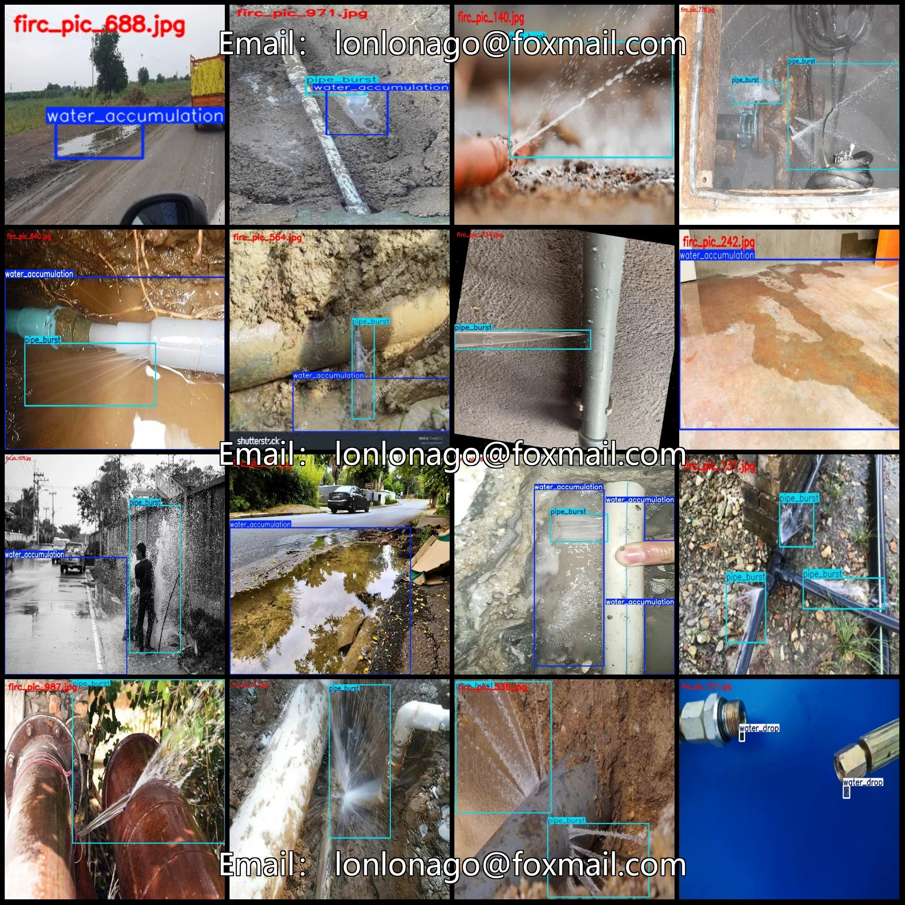
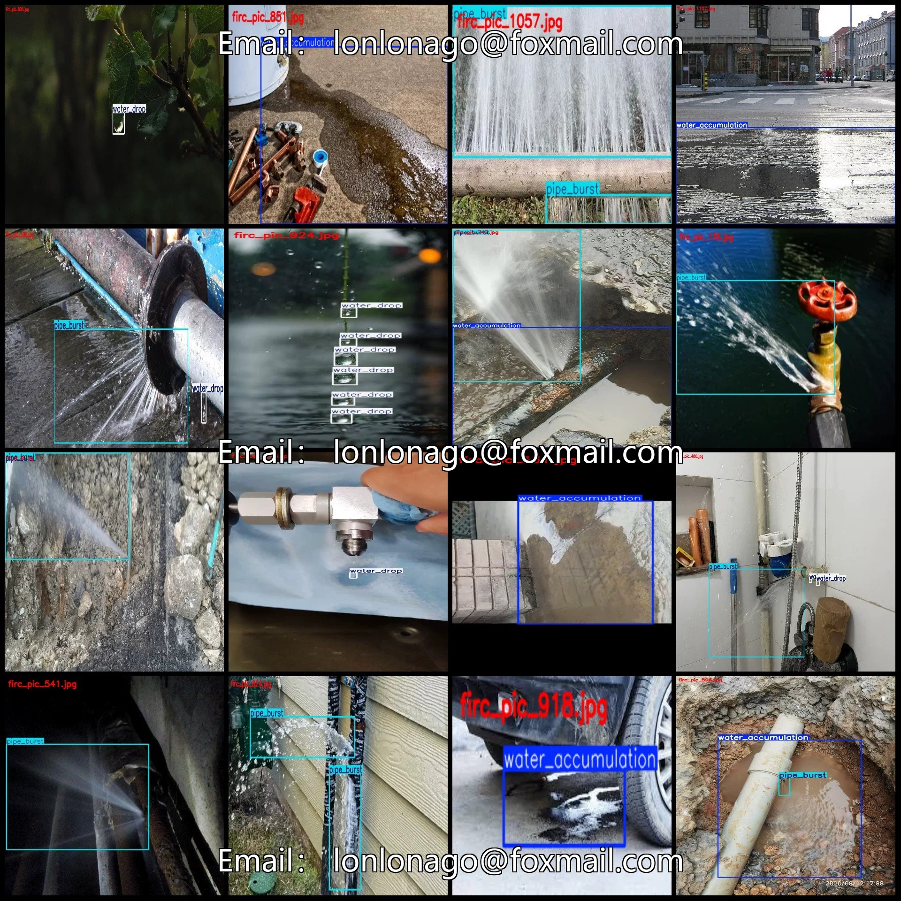
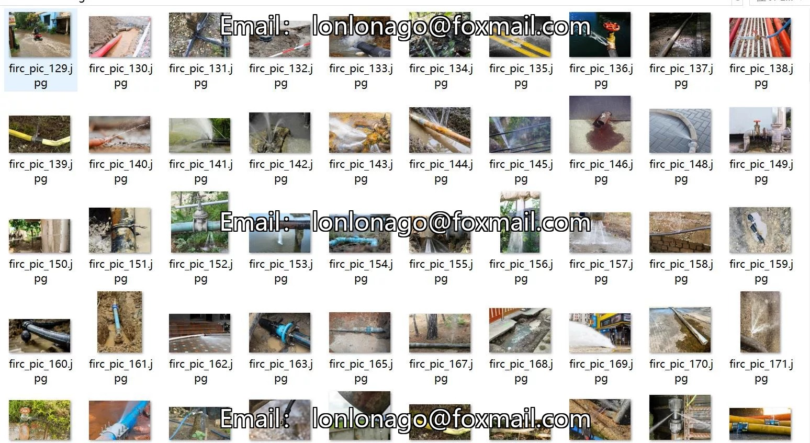
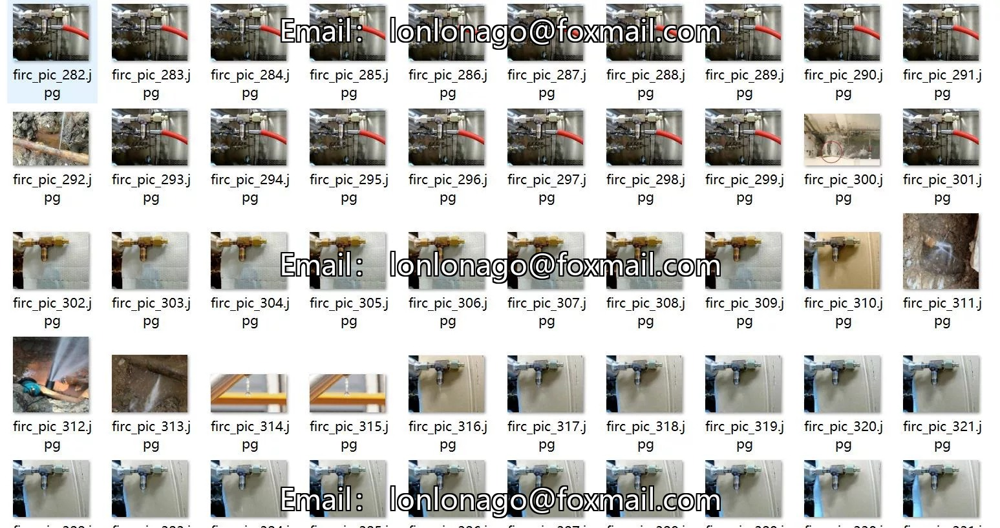
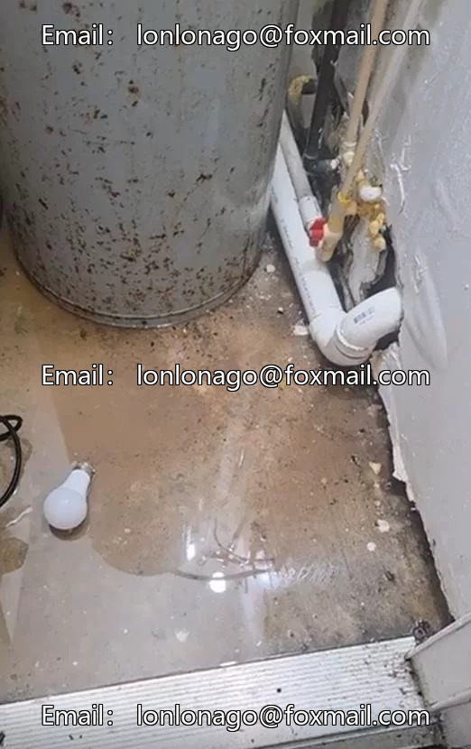
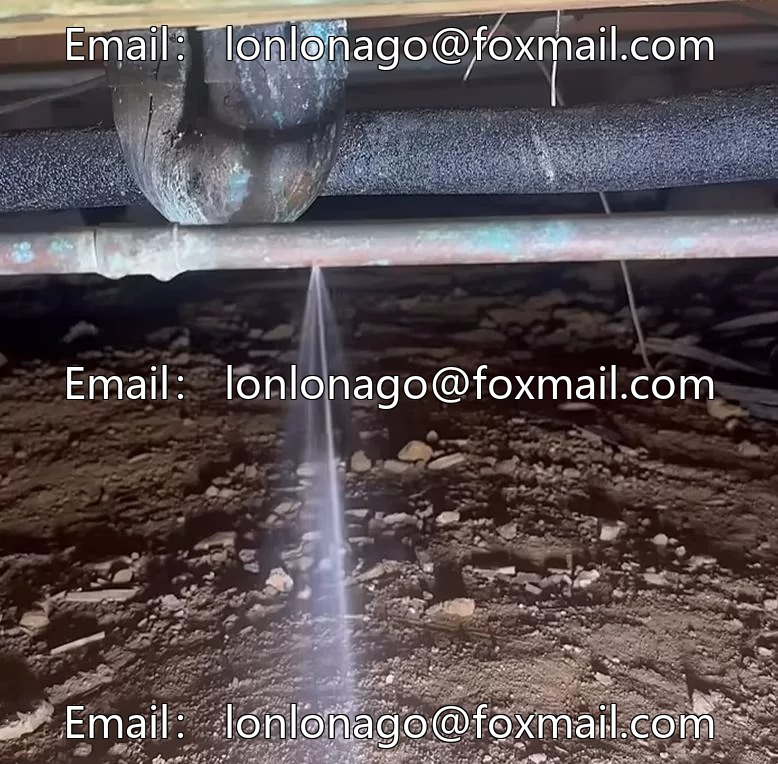
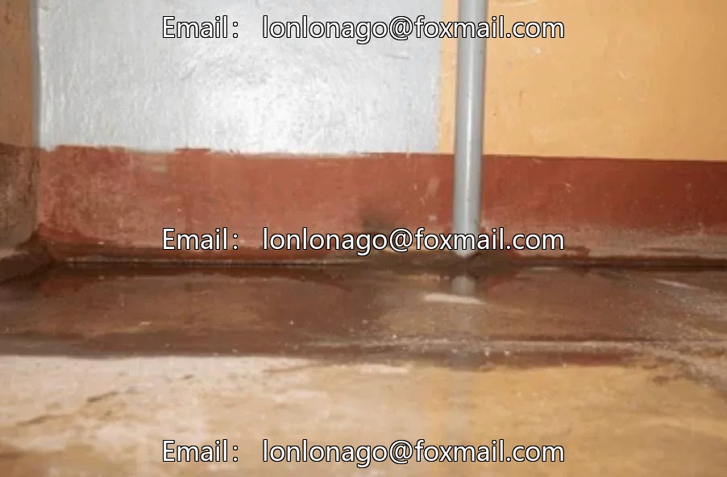

# Pipeline leakage and water accumulation detection dataset VOC+YOLO format with 1306 images in 3 categories

## Body

Pipeline Leakage and Water Accumulation Detection Dataset VOC+YOLO format: 1306 images in 3 categories
Tips: Due to the dataset's replicability, please confirm compliance before purchasing.
Dataset format: Pascal VOC format + YOLO format (txt files without split paths, only containing jpg images along with corresponding VOC format xml files and yolo format txt files)
Number of images (number of jpg files): 1306
Number of annotations (number of xml files): 1306
Number of annotations (number of txt files): 1306
Number of annotation categories: 3

Annotation Category Names (Note that the order of categories in the yolo format does not correspond to this, but is based on the labels folder's classes.txt): ["pipe_burst", "water_accumulation", "water_drop"]
Number of boxes and image counts for each category:
- pipe_burst (Pipe Burst) = 652 boxes, 569 images
- water_accumulation (Water Accumulation) = 734 boxes, 627 images
- water_drop (Water Drop) = 881 boxes, 323 images
Total number of boxes: 2267

Image resolution: Multi-resolution images, such as 754x494, 500x375, etc.
Using labeling tool: labelImg
Labeling rules: Draw a rectangle around the category
Important note: The dataset does not have separate training, validation, and test sets; you need to partition them yourself.
Special declaration: This dataset does not guarantee the accuracy of the trained models or weight files.

## Images

## Payment

Here is a pay link on Stripe ( https://buy.stripe.com/3cs8yP7sY87d0vu9AB ). Please contact me lonlonago@foxmail.com after funding $89, and I will send you a complete data files , thank you!

